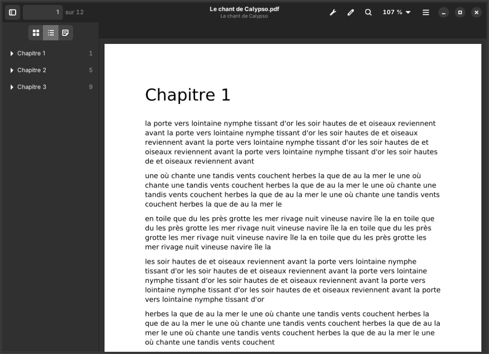
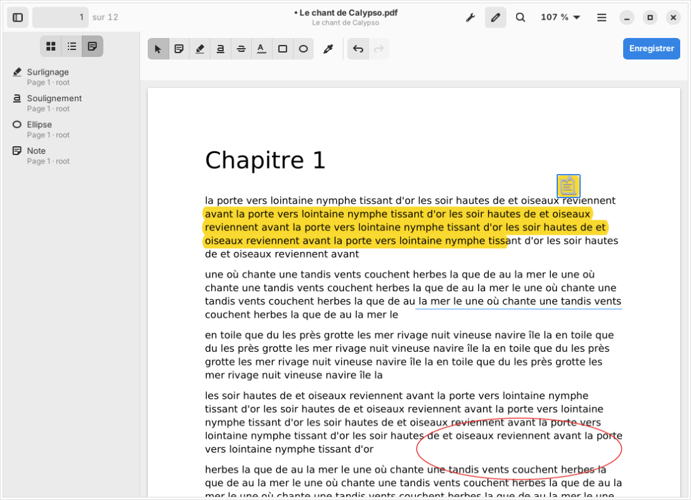
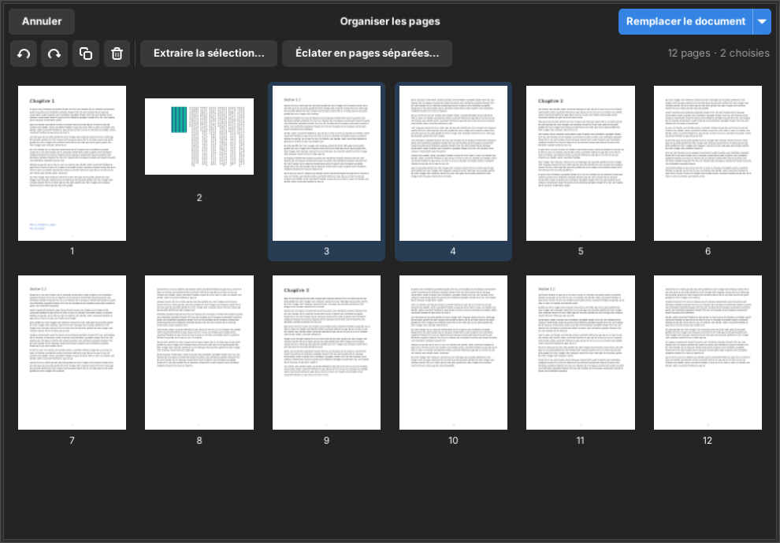
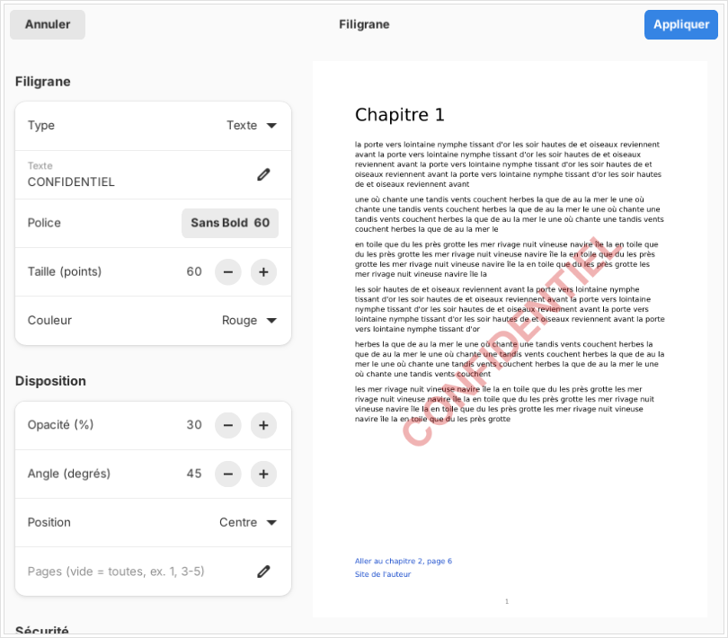
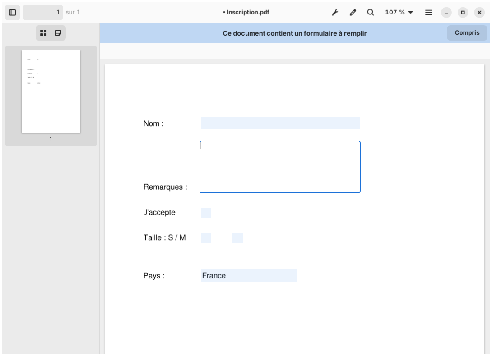
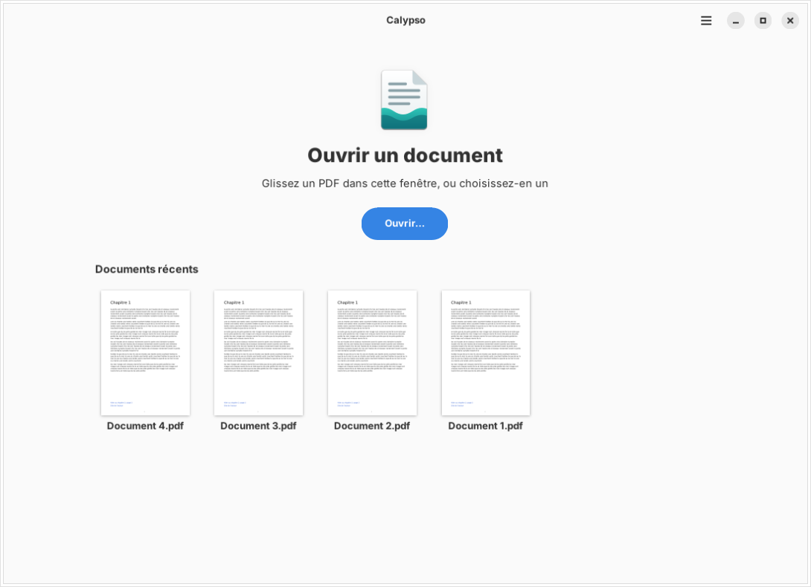

# Calypso

**A PDF document viewer for GNOME, with the tools to change them — GTK4 / libadwaita.**
**Une visionneuse de documents PDF pour GNOME, avec les outils pour les modifier — GTK4 / libadwaita.**

[English](#english) · [Français](#français) · Site : https://tofmicro.pages-perso.free.fr/Calypso/



| Annoter / Annotate | Organiser les pages / Organize pages | Filigrane / Watermark |
|---|---|---|
|  |  |  |

| Formulaire / Form | Accueil / Welcome |
|---|---|
|  |  |

---

## English

Calypso reads PDF documents like GNOME Papers (same engine, Poppler), annotates them, fills in forms, checks
and adds digital signatures, and brings the PDF tools of the [Odysseus](https://github.com/ToFpon/Odysseus)
file manager. It follows your desktop theme (Adwaita, light or dark, accent colour, installed GTK4 theme).

### Features
- **Reading**: continuous or page-by-page scrolling, two pages side by side (first page alone as an option),
  zoom (fit width / page, Ctrl + wheel, pinch), rotation, night mode, full screen, presentation mode (F5),
  printing (Ctrl+P).
- **Sidebar**: thumbnails, outline, annotations, signatures, search results.
- **Search** ignoring accents and case, text selection and copy, links with a preview on hover, history
  (Alt+← / →), right click to copy or save an image.
- Password-protected documents, automatic reload when the file changes, each document reopens at its page,
  zoom and layout, recent documents on the welcome page.
- **Annotations**: notes, highlight, underline, strike out, squiggly underline, rectangles, ellipses, six
  colours, comments, Ctrl+Z; **forms**: text, check boxes, radio buttons, lists. Saved into the file
  (Ctrl+S), safely.
- **Digital signatures**: checked when the document opens; sign with your certificate (.p12 / .pfx import,
  or the certificates of Firefox).
- **Tools**: organize pages (drag thumbnails, rotate, duplicate, delete, extract, split — with Undo), merge,
  compress, watermark (live preview), redact (the text underneath is really gone), protect with a password
  (AES-256, permissions, password generator), remove the password.

### Install
Ubuntu 24.04 / 26.04, Zorin OS 18, Linux Mint 22:
```sh
sudo add-apt-repository ppa:nourpon/calypso
sudo apt update && sudo apt install calypso
```
Other Debian-based distributions: the `.deb` of the [releases](https://github.com/ToFpon/Calypso/releases),
then `sudo apt install ./calypso_X_all.deb`. From the source code: `./install.sh` (in `~/.local`).

---

## Français

Calypso lit les documents PDF comme Papers (même moteur, Poppler), les annote, remplit les formulaires,
vérifie et ajoute des signatures numériques, et apporte les outils PDF du gestionnaire de fichiers
[Odysseus](https://github.com/ToFpon/Odysseus). Elle suit le thème du bureau (Adwaita, clair ou sombre,
couleur d'accent, thème GTK4 installé).

### Fonctionnalités
- **Lecture** : défilement continu ou page par page, deux pages côte à côte (première page seule en option),
  zoom (largeur, page, Ctrl + molette, pincement), rotation, mode nuit, plein écran, présentation (F5),
  impression (Ctrl+P).
- **Panneau latéral** : miniatures, sommaire, annotations, signatures, résultats de la recherche.
- **Recherche** sans tenir compte des accents ni de la casse, sélection et copie du texte, liens avec aperçu
  au survol, historique (Alt+← / →), clic droit pour copier ou enregistrer une image.
- Documents protégés par un mot de passe, rechargement automatique, chaque document rouvre à sa page, son
  zoom et sa disposition, documents récents à l'accueil (croix au survol pour en retirer un).
- **Annotations** : notes, surligner, souligner, barrer, souligner en vague, rectangles, ellipses, six
  couleurs, commentaires, Ctrl+Z ; **formulaires** : champs texte, cases, boutons radio, listes. Enregistrés
  dans le fichier (Ctrl+S), sans risque.
- **Signatures numériques** : vérifiées à l'ouverture ; signer avec son certificat (import .p12 / .pfx, ou
  les certificats de Firefox).
- **Outils** : organiser les pages (glisser les miniatures, pivoter, dupliquer, supprimer, extraire,
  éclater — avec « Annuler »), fusionner, compresser, filigrane (aperçu), caviarder (le texte dessous
  disparaît vraiment), protéger par un mot de passe (AES-256, droits, générateur), retirer le mot de passe.

### Installation
Ubuntu 24.04 / 26.04, Zorin OS 18, Linux Mint 22 :
```sh
sudo add-apt-repository ppa:nourpon/calypso
sudo apt update && sudo apt install calypso
```
Autres distributions basées sur Debian : le `.deb` des [releases](https://github.com/ToFpon/Calypso/releases),
puis `sudo apt install ./calypso_X_all.deb`. Depuis le code : `./install.sh` (dans `~/.local`).

License: GPL-3.0.
